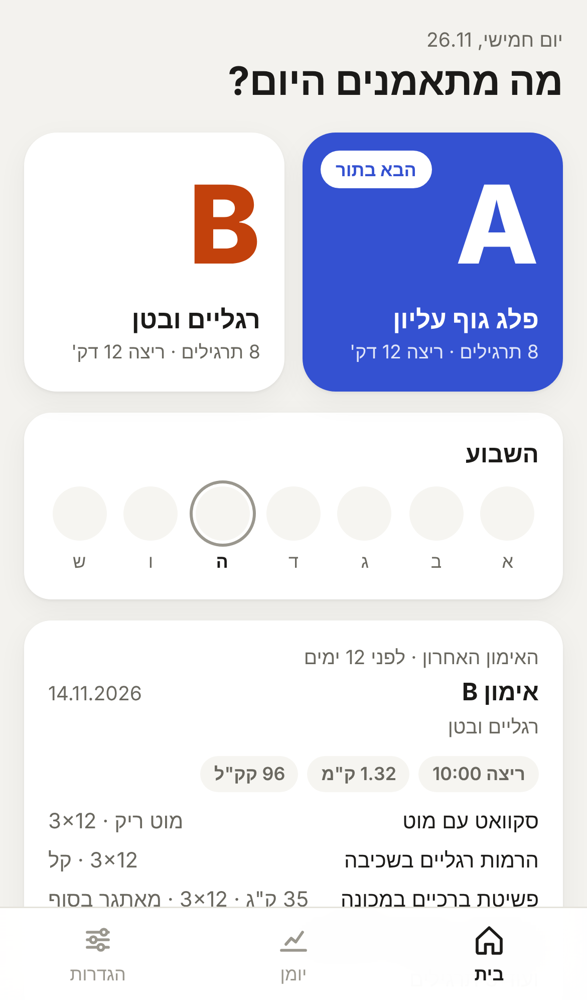
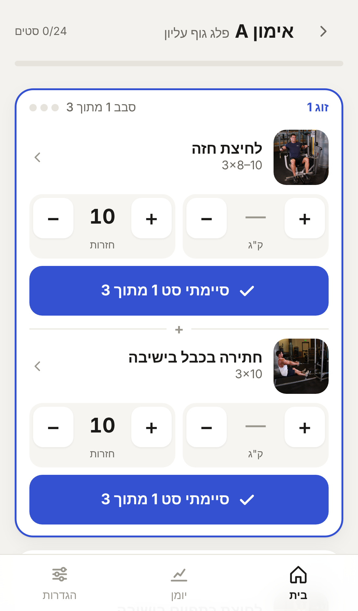
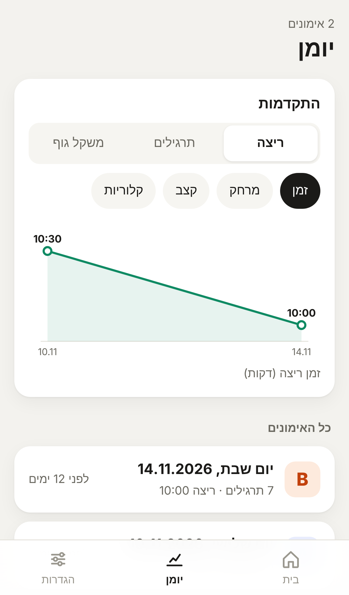

# GymTrack

A mobile-first workout tracker I built for my own gym routine. It's an installable Progressive Web App (PWA) that works offline, with no backend and no account, plus optional two-way sync to a Google Sheet.

**Live app:** https://noamdan645.github.io/GymTrack/ (Hebrew UI, best viewed on a phone) · [עברית](README.he.md)

<p>
  
  
  
</p>

## Features

- **Workout plans A/B** with supersets, per-exercise tips, start/end images and the muscles each exercise works (front/back body illustration).
- **Fast logging** of sets, reps and weight with large touch targets; the next suggested workout is picked automatically.
- **Progress charts** for running (time, distance, pace, calories), per-exercise weights and body weight, drawn as plain SVG.
- **Offline first:** a service worker caches the app, and it can be added to the home screen like a native app.
- **Your data stays yours:** everything is stored in `localStorage`, with JSON export/import for backups.
- **Google Sheets sync:** a small Apps Script web app receives the data and writes it to a sheet. You can edit the sheet and pull changes back; the app detects manual edits and asks before overwriting.
- **Continuous deployment** to GitHub Pages with GitHub Actions on every push to `main`.

## Tech

Vanilla JavaScript (no framework, no build step), HTML, CSS, Service Worker + Web App Manifest, Google Apps Script, GitHub Actions / GitHub Pages.

## Project structure

```
index.html, style.css, app.js   UI and app logic
data.js                         Exercises, A/B plans and default history
muscles.js                      Front/back body illustration per exercise
sync.js, sheets-backup.gs       Google Sheets sync (client and Apps Script)
sw.js, manifest.webmanifest     Offline support and installability
.github/workflows/deploy.yml    Deploy to GitHub Pages
```

## Run locally

```bash
python -m http.server 4173
# open http://localhost:4173
```

## Credits

Exercise images from [free-exercise-db](https://github.com/yuhonas/free-exercise-db) (public domain).
